# 🛡️ Awesome-AI-Cybersecurity-Automated-Threat-Defense

  

  
  
  
  
  

---

## ⚡ Top AI Cybersecurity & Automated Threat Defense Ecosystem

**A Curated List of SaaS Platforms & Open-Source Security Tools for AI-Driven Threat Detection, Autonomous SOC, Incident Response, EDR/XDR, and LLM Defense.**

> 🔍 **Keywords / SEO Metadata**: *AI Cybersecurity, Autonomous Threat Defense, AI SOC Automation, Incident Response Automation, Open-Source EDR, XDR, NDR, AI Pentesting, Threat Intelligence, LLM Guardrails, Purple Teaming, MITRE ATT&CK Automation, Wazuh, PentestGPT, CrowdStrike Charlotte AI, SentinelOne Purple AI, Cortex XDR, DFIR, SOAR.*

**Last updated: November 2026** 📅

This repository tracks notable **enterprise SaaS platforms** and **active open-source projects** in **AI Cybersecurity & Automated Threat Defense**. These technologies leverage artificial intelligence, behavioral anomaly detection, machine learning, and autonomous agent loops to detect zero-day intrusions, triage SOC alerts, automate incident response playbooks, scan complex vulnerabilities, and harden enterprise infrastructure.

---

## 📑 Table of Contents

- [📊 Sector Overview & Market Dynamics](#-sector-overview--market-dynamics)
- [🏢 Enterprise SaaS / Hosted Platforms](#-enterprise-saas--hosted-platforms)
- [🔓 Open-Source GitHub Projects](#-open-source-github-projects)
- [🤝 How to Contribute](#-how-to-contribute)
- [💖 Support & Sponsorship](#-support--sponsorship)
- [📈 Star History](#-star-history)
- [⚠️ Disclaimer](#️-disclaimer)

---

## 📊 Sector Overview & Market Dynamics

The global AI in Cybersecurity and Automated Threat Defense market is estimated at approximately **$39B – $51B in 2026** (scaling past $180B+ by the mid-2030s at an estimated CAGR of ~22%). The sector exhibits a **moderately concentrated platform core with a fragmented innovation edge**: while dominant security titans (Palo Alto Networks, CrowdStrike, Zscaler) capture the lion's share of enterprise budgets via unified XDR and SASE ecosystems, niche domains (agentic red/blue teaming, DSPM, and LLM guardrails) remain highly fragmented with hundreds of emerging point startups that continuously get consolidated or acquired.

---

## 🏢 Enterprise SaaS / Hosted Platforms

| Company / Product | Company Size (Market Cap / Valuation / ARR) | Starting Pricing | Free Tier / Free Trial Limits | Description |
| :--- | :--- | :--- | :--- | :--- |
| **[Palo Alto Networks Cortex XDR & XSIAM](https://paloaltonetworks.com)** 🛡️ | ~$198B - $264B Market Cap (~$11.5B ARR) | $40 / endpoint / year (Cortex XDR Prevent tier; Pro tier starts at $70 / endpoint / year) | 30-day guided Proof of Concept (PoC) / evaluation upon enterprise request (no permanent free tier) | AI-driven security operations and extended detection and response platform correlating endpoint, network, and cloud telemetry to automate SOC investigations. |
| **[CrowdStrike Falcon (Charlotte AI)](https://crowdstrike.com)** 🦅 | ~$230B - $235B Market Cap (~$5.4B ARR) | $59.99 / device / year ($7.99/mo, Falcon Go tier; Enterprise tier starts at $184.99 / device / year) | 15-day free trial (up to 100 endpoints with NGAV, device control, and Falcon Insight XDR modules; no permanent free tier) | Cloud-native endpoint detection and response (EDR/XDR) platform powered by Charlotte AI for autonomous alert triage, threat hunting, and real-time breach prevention. |
| **[Zscaler Zero Trust & AI Security](https://zscaler.com)** 🌐 | ~$30B - $31B Market Cap (~$3.35B ARR) | ~$100 / user / year (ZIA/ZPA foundational business bundles; Advanced Transformation suites start at $300 - $375 / user / year) | 30-day proof-of-concept / guided enterprise trial with interactive live demo lab (no permanent free tier) | Cloud-native Zero Trust Exchange incorporating AI-powered threat prevention, inline data loss prevention (DLP), and generative AI traffic governance. |
| **[SentinelOne Singularity (Purple AI)](https://sentinelone.com)** 🟣 | ~$7.7B Market Cap (~$1.0B - $1.1B ARR) | $69.99 / endpoint / year (Singularity Core; Complete EDR starts at $179.99 / endpoint / year) | 30-day guided enterprise Proof of Concept (POC) / trial via sales evaluation (no permanent free tier) | Autonomous XDR and endpoint protection platform featuring Purple AI security analyst capabilities for natural-language threat hunting and automated remediation. |
| **[Darktrace (ActiveAI Security Platform)](https://darktrace.com)** 🧠 | $5.3B Acquisition Valuation (~$685M ARR) | ~$20,000 - $35,000 / year (Foundational entry-level network/cloud deployment; median contracts ~$55,200 / year) | 30-day Cyber Threat and Risk Mitigation Proof of Value (POV) deployment with dedicated appliance/cloud sensor (no permanent free tier) | Self-learning cyber AI platform utilizing behavioral anomaly detection and Autonomous Response to neutralize novel threats across cloud, network, email, and endpoints. |
| **[Trellix XDR](https://trellix.com)** 🔄 | ~$5.2B Combined PE Valuation (~$940M - $1.1B ARR) | ~$2,000 / year base entry SKU / block (standard enterprise seats ~£20 - £35 / user / year) | 30-day evaluation / trial license via enterprise sales request or AWS Marketplace sandbox (no permanent free tier) | Adaptive extended detection and response platform combining machine-learning threat intelligence with automated security operations workflows across hybrid environments. |
| **[Vectra AI](https://vectra.ai)** 📡 | $1.2B Valuation (~$120M - $178M ARR) | ~$8 - $22 / IP / year (Network Detection & Response; baseline mid-market contracts start ~$150,000 / year) | 30-day guided Proof of Concept (POC) evaluating live network/M365 cloud traffic metadata (no permanent free tier) | AI-powered network detection and response (NDR) and attack-signal intelligence platform uncovering hybrid-cloud lateral movement, identity compromise, and C2 activity. |
| **[Cybereason Defense Platform](https://cybereason.com)** 🦉 | ~$850M Valuation (~$120M - $200M ARR) | ~$40 / endpoint / year (Foundational NGAV/EDR tier; scaling to $70+ / endpoint / year for automated MalOp XDR) | 30-day guided enterprise Proof of Concept (POC) / evaluation (no permanent free tier) | Cloud EDR/XDR and MalOp (Malicious Operation) detection platform providing AI-assisted root-cause correlation and automated endpoint containment. |
| **[Deep Instinct](https://deepinstinct.com)** 🧬 | ~$500M - $1.0B Valuation (~$10M - $60M ARR) | ~$40 / endpoint / year (Baseline predictive deep-learning prevention tier) | 30-day guided enterprise Proof of Concept (POC) / trial on test endpoints (no permanent free tier) | Deep-learning cybersecurity platform trained on raw binary data to predict and prevent zero-day malware and ransomware in sub-20 milliseconds prior to execution. |
| **[Skyhigh Security (formerly McAfee MVISION Cloud)](https://skyhighsecurity.com)** ☁️ | ~$400M+ Segment Value (~$100M - $250M ARR) | ~£16.77 / user / month (~$215 / user / year on standard public procurement cloud frameworks) | 30-day enterprise Proof of Concept (PoC) / guided interactive online simulation demo (no permanent free tier) | Cloud-native Security Service Edge (SSE) and CASB platform offering AI-assisted data protection, shadow-AI discovery, and zero-trust cloud access control. |

---

## 🔓 Open-Source GitHub Projects

Sorted in descending order by GitHub star count ⭐. Each repository includes a real-time star badge linking directly to its stargazers page.

- **[Ghidra (`NationalSecurityAgency/ghidra`)](https://github.com/NationalSecurityAgency/ghidra)**  🔬  
  National Security Agency's open-source (`Apache-2.0`) software reverse engineering (SRE) suite. Frequently paired with LLM and MCP agents for autonomous binary reverse engineering, malware disassembly, and decompiler analysis.

- **[Trivy (`aquasecurity/trivy`)](https://github.com/aquasecurity/trivy)**  🔍  
  Comprehensive open-source (`Apache-2.0`) vulnerability, misconfiguration, secret, and SBOM scanner for containers, Kubernetes, code repositories, and cloud workloads with CI/CD integration.

- **[Anthropic Cybersecurity Skills (`mukul975/Anthropic-Cybersecurity-Skills`)](https://github.com/mukul975/Anthropic-Cybersecurity-Skills)**  🧠  
  Extensive collection of modular `SKILL.md` cybersecurity playbooks and agentic tool configurations empowering AI security assistants across threat hunting, DFIR, malware triage, and defense hardening.

- **[Nuclei (`projectdiscovery/nuclei`)](https://github.com/projectdiscovery/nuclei)**  🎯  
  Fast and customizable open-source (`MIT`) vulnerability scanner based on simple YAML DSL templates, widely leveraged by autonomous red-team agents and security researchers for targeted exploit verification.

- **[OSQuery (`osquery/osquery`)](https://github.com/osquery/osquery)**  💻  
  Operating system instrumentation framework (`Apache-2.0` / `GPL-2.0`) that exposes an OS as a high-performance relational database, enabling SQL queries to detect anomalies, rootkits, and unauthorized processes.

- **[Wazuh (`wazuh/wazuh`)](https://github.com/wazuh/wazuh)**  🛡️  
  Full-featured open-source (`GPL-2.0`) unified XDR and SIEM platform providing endpoint security monitoring, log analysis, file integrity monitoring (FIM), vulnerability detection, and active threat response.

- **[PentestGPT (`GreyDGL/PentestGPT`)](https://github.com/GreyDGL/PentestGPT)**  🤖  
  LLM-powered penetration testing agent (`MIT`) designed to assist security professionals through interactive guided reconnaissance, exploit generation, post-exploitation, and automated reporting.

- **[CrowdSec (`crowdsecurity/crowdsec`)](https://github.com/crowdsecurity/crowdsec)**  👥  
  Open-source (`MIT`) collaborative security engine and intrusion prevention system (IPS) analyzing behavioral telemetry to block aggressive actors and share real-time threat intelligence globally.

- **[Atomic Red Team (`redcanaryco/atomic-red-team`)](https://github.com/redcanaryco/atomic-red-team)**  🧪  
  Library of simple, open-source (`MIT`) scripted tests mapped directly to the MITRE ATT&CK framework for validating enterprise detection pipelines, SIEM correlation rules, and autonomous defenders.

- **[Sigma (`SigmaHQ/sigma`)](https://github.com/SigmaHQ/sigma)**  📜  
  Generic and open signature format (`DRL-1.1`) for SIEM systems, allowing security teams and AI models to write vendor-agnostic threat detection rules convertible to Splunk, Elastic, Sentinel, and QRadar.

- **[Garak (`NVIDIA/garak`)](https://github.com/NVIDIA/garak)**  🦹  
  Generative AI vulnerability scanner (`Apache-2.0`) by NVIDIA that probes LLMs for prompt injection, hallucinations, data leaks, jailbreaks, toxicity, and model extraction vulnerabilities.

- **[CAI — Cybersecurity AI (`aliasrobotics/cai`)](https://github.com/aliasrobotics/cai)**  🦾  
  Modular open-source (`AGPL-3.0`) framework tailored for AI security agents, facilitating autonomous offensive red-teaming, blue-team SOC defense, and CTF/exploit discovery workflows.

- **[Falco (`falcosecurity/falco`)](https://github.com/falcosecurity/falco)**  🦅  
  Cloud-native runtime security project (`Apache-2.0`, CNCF Graduated) using Linux eBPF to monitor kernel system calls and detect anomalous behavior across Kubernetes pods and Linux nodes in real time.

- **[Zeek (`zeek/zeek`)](https://github.com/zeek/zeek)**  📊  
  Powerful open-source network traffic analysis framework (`BSD-3-Clause`) translating raw packet streams into structured event streams and high-fidelity transaction logs optimized for ML analysis.

- **[Arkime (`arkime/arkime`)](https://github.com/arkime/arkime)**  🗄️  
  Large-scale, open-source (`Apache-2.0`) indexed packet capture (PCAP) and network traffic search system providing deep security visibility and incident forensics investigation tools.

- **[CALDERA (`mitre/caldera`)](https://github.com/mitre/caldera)**  ⚔️  
  Scalable, automated adversary emulation system (`Apache-2.0`) built by MITRE on the ATT&CK framework, enabling automated blue-team validation and autonomous breach-and-attack simulation.

- **[NeMo Guardrails (`NVIDIA/NeMo-Guardrails`)](https://github.com/NVIDIA/NeMo-Guardrails)**  🚧  
  Open-source toolkit (`Apache-2.0`) for establishing programmatic safety, topical, and execution boundaries around LLM applications and conversational AI agents.

- **[Suricata (`OISF/suricata`)](https://github.com/OISF/suricata)**  🚨  
  Mature open-source (`GPL-2.0`) high-performance Network Threat Detection, IDS, IPS, and Network Security Monitoring (NSM) engine capable of multi-gigabit inspection.

- **[MISP (`MISP/MISP`)](https://github.com/MISP/MISP)**  🌐  
  Leading open-source (`AGPL-3.0`) threat sharing platform and open standard for collecting, storing, and distributing Indicators of Compromise (IoCs) and threat actor intelligence.

- **[Purple Llama (`meta-llama/PurpleLlama`)](https://github.com/meta-llama/PurpleLlama)**  🦙  
  Meta's open-source (`MIT`) umbrella project featuring CyberSecEval benchmarks and cybersecurity evaluation tools to assess LLM security risks and defensive code generation.

- **[Velociraptor (`Velocidex/velociraptor`)](https://github.com/Velocidex/velociraptor)**  🦖  
  Advanced digital forensics and incident response (DFIR) platform (`AGPL-3.0`) utilizing Velociraptor Query Language (VQL) for fleet-wide real-time hunting and endpoint forensics collection.

- **[TheHive (`TheHive-Project/TheHive`)](https://github.com/TheHive-Project/TheHive)**  🐝  
  Scalable, open-source (`AGPL-3.0`) Security Incident Response Platform (SIRP) closely integrated with MISP and Cortex for alert triage, digital forensics tracking, and case management.

- **[Tracecat (`TracecatHQ/tracecat`)](https://github.com/TracecatHQ/tracecat)**  🐱  
  AI-native, open-source (`AGPL-3.0`) security automation and SOAR engine designed as an alternative to Tines/Splunk SOAR, enabling automated alert enrichment and LLM triage.

- **[Snort 3 (`snort3/snort3`)](https://github.com/snort3/snort3)**  🐽  
  Next-generation open-source (`GPL-2.0`) network intrusion prevention system (NIPS) featuring multithreading, pluggable architecture, and modern packet processing.

- **[Shuffle (`Shuffle/Shuffle`)](https://github.com/Shuffle/Shuffle)**  🔀  
  Open-source (`AGPL-3.0`) visual automation platform and SOAR solution connecting enterprise SIEMs, threat intelligence APIs, and LLM nodes for automated incident response.

- **[Nosey Parker (`praetorian-inc/noseyparker`)](https://github.com/praetorian-inc/noseyparker)**  👃  
  High-performance secret scanning tool (`Apache-2.0`) implemented in Rust to detect API keys, tokens, and credentials in git history, filesystems, and continuous integration pipelines.

- **[Malcolm (`idaholab/Malcolm`)](https://github.com/idaholab/Malcolm)**  📦  
  Powerful, easily deployable network traffic analysis suite (`Apache-2.0`) developed by Idaho National Laboratory, combining Zeek, Suricata, Arkime, and OpenSearch for cyber anomaly discovery.

---

## 🤝 How to Contribute

Contributions are warmly encouraged! To propose a new SaaS platform, open-source project, or market update:

1. 🍴 **Fork** this repository.
2. 🌿 Create a feature branch: `git checkout -b feature/add-new-security-tool`.
3. ✍️ Add the tool in alphabetical order or in its proper star-count position. Ensure factual descriptions, verified links, and specific pricing / star badges.
4. 💾 Commit your changes: `git commit -m 'feat: add <tool-name>'`.
5. 🚀 Push to branch: `git push origin feature/add-new-security-tool`.
6. 📬 Submit a **Pull Request**!

---

## 💖 Support & Sponsorship

If you find this curated ecosystem valuable for your security research, SOC engineering, or AI defense workflows, please consider supporting the project:

- ⭐ **Star** this repository to help other defenders and researchers discover it!
- 🍴 **Fork** and share it with your security team and community.
- ☕ **Buy a Coffee / Sponsor**: Support ongoing maintenance and research on the [GitHub Sponsor Dashboard](https://github.com/sponsors/ishandutta2007).

---

## 📈 Star History

---

## ⚠️ Disclaimer

This list is for educational, defensive, and research purposes only. All company names, logos, and trademarks are the property of their respective owners. Mention of SaaS solutions and software packages does not imply direct commercial endorsement.
